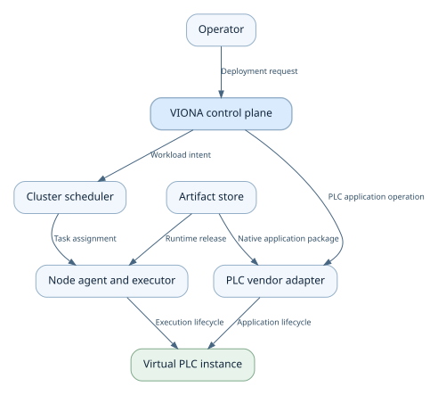
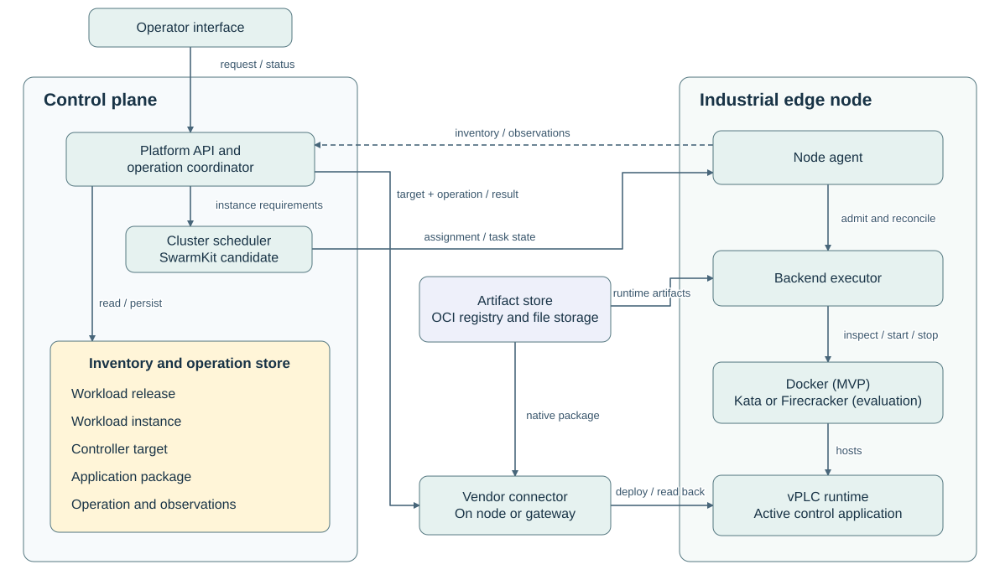

[Documentation home](index.md) · [Workloads and execution](execution.md) · [Roadmap](roadmap.md)

# Architecture

Koinodos is designed to operate virtual PLCs and supporting services across industrial PCs. It coordinates placement, installation, application deployment, and diagnostics. The controller executes the control loop locally and owns its behavior when communications fail. A loss of the Koinodos control plane or its connection to a node must not by itself stop running controller logic.

## Architecture overview

| Component | Responsibility |
| --- | --- |
| **Control plane** | Stores desired workload state, inventory, and the operation history. Authorizes changes, selects the placement path, and presents observed state with its timestamp and source. |
| **Cluster scheduler** | Assigns workload tasks to suitable nodes based on capacity and constraints. Direct reuse of SwarmKit is the leading candidate. The Docker prototype will test the scheduling path for container workloads. |
| **Node agent and executors** | Report capabilities, confirm that assigned resources can be reserved, and manage execution through the selected backend. Reconcile local processes, containers, or VMs after restart. |
| **Vendor adapters** | Translate controller operations to the vendor's supported interfaces. Report available actions and observed application state. An adapter can run on the node or on a reachable gateway. |
| **Artifact store** | Holds versioned runtime images and native application packages by immutable identity and digest. Existing registries or storage services can provide the underlying storage. |
| **Operator interface** | Exposes inventory, deployment intent, progress, diagnostics, and audit history. It uses the control-plane API and displays actions supported by the target. |

The orchestration agent is outside the real-time path. The control plane issues workload and deployment requests, while the controller retains local access to its drivers, I/O, and application state.

## Detailed architecture

[Open the full-size diagram](assets/architecture-detailed.svg). The boxes inside the inventory and operation store are records. The other boxes identify software components or the systems they manage. Edge labels describe the requests and results exchanged between them. This is the proposed design. The prototype will establish the interfaces and deployment boundaries.

| Component | Responsibility and proposed implementation |
| --- | --- |
| **Operator interface** | A fleet view backed by the platform API. An engineer can select a controller, inspect its operating data, see which revision is active, and follow an operation through to its result. The connector supplies the actions and diagnostics available for that controller. |
| **Control plane** | The platform API authenticates callers and checks permissions. An operation coordinator records the requested change, assigns an operation ID, and routes the work. It submits instance placement to the scheduler and sends application operations to the connector responsible for the target. |
| **Inventory and operation store** | A durable store behind the API holds releases, desired instances, controller identities, package metadata, and operation history. Observations retain their source and observation time so a disconnected node’s last report remains identifiable. The database engine is an open implementation choice. |
| **Cluster scheduler** | Selects an eligible node from the instance requirements and available capacity, then issues an assignment. Direct reuse of SwarmKit is the leading candidate for the Docker prototype. An assignment identifies where to attempt a launch. The node confirms whether it can reserve the resources. |
| **Node agent and executors** | The agent reports node capabilities, admits assignments, reserves local resources, and reconciles existing instances after restart. A backend executor translates the assignment into calls to the local runtime and reports the actual instance identity and state. The Docker executor comes first. |
| **Vendor connectors (adapters)** | Each participating vendor can implement a connector for its vPLC using the common platform interface. The connector translates deployment and diagnostic requests into supported vendor operations, checks compatibility, and reads back the result. It can run on the node or on a gateway that can reach the controller. |
| **Artifact store** | An OCI registry can hold runtime images. Versioned file or object storage can hold guest kernels, root filesystems, and native PLC packages. The inventory records immutable references and digests. The executor retrieves runtime artifacts, while the connector retrieves the application package. |
| **Execution backend and vPLC runtime** | Docker hosts the vPLC in the MVP. Later trials will evaluate a Kata-capable container runtime and direct Firecracker microVMs. Inside the selected environment, the vPLC runs the control application and owns its control loop, drivers, and I/O. |

## Workload and controller identity

Consider a packaging line with two controllers running the same runtime version. They can share a workload release while using different application packages. The following records describe one of the controllers. Identifiers are illustrative.

| Record in the diagram | Example | Purpose and relationships |
| --- | --- | --- |
| **Workload release** | `runtime-2.1` | Catalog entry for a particular version of a runtime or supporting service. Lists compatible artifacts by backend, architecture, and digest. Several instances can reference the same release. |
| **Workload instance** | `line-1-runtime` | Desired deployment of a release. Records the selected backend, resource requirements, and placement constraints. The scheduler assigns a node, and the agent associates the actual container or VM with this stable instance ID. A node may host several instances. |
| **Controller target** | `line-1-plc` | Stable identity used for PLC operations. Associates the controller with its connector and current endpoint. A managed target links to its hosting instance. An externally managed PLC can be enrolled with its own endpoint. Endpoint addresses and backend IDs can change after restart. |
| **Application package** | `line-1-control-r17` | Vendor-native engineering artifact with a version, digest, and declared target compatibility. Deploying a new package updates the application on the selected target independently of the workload release. |
| **Operation and observations** | Deploy `line-1-control-r17` to `line-1-plc` | The operation links the request, target, package, and result. The executor reports whether the instance is running. The connector reports whether the controller is reachable and which application revision it can verify. The UI shows each observation with its source and time. If the vendor cannot report the revision, it is shown as unverified. |

## Communication paths

These are candidate interfaces for implementation. The arrows show logical exchanges, including results that travel back along the same path.

| Path in the diagram | Proposed interface and exchange |
| --- | --- |
| **Operator interface ↔ platform API** | HTTPS with JSON for fleet queries and authorized changes. A change returns an operation ID that the UI can use to retrieve progress, results, and observations. |
| **Coordinator ↔ store and scheduler** | Persist the desired state and operation before dispatch. An internal scheduler integration maps the workload instance to a task with placement constraints and records the task ID. The Docker prototype will test the SwarmKit integration boundary. |
| **Scheduler ↔ node agent** | With SwarmKit, use its manager–worker assignment and task-status path. The worker passes assignments to the executor. The agent reports admission failures, backend state, and resource availability. |
| **Node agent ↔ platform API** | Use an authenticated, encrypted node channel for inventory and timestamped observations. Reports carry stable node and instance IDs so the coordinator can correlate them after a reconnect. |
| **Agent ↔ executor ↔ backend** | A local executor interface covers inspection, start, stop, and reconciliation. The Docker executor uses the Docker Engine API. The Kata evaluation will test a Kata-compatible runtime path. The direct Firecracker executor would configure and control the microVM through its local API. |
| **Coordinator ↔ vendor connector ↔ controller** | The proposed connector interface carries the operation ID, stable target ID, requested action, and package reference. An authenticated channel returns capabilities, progress, diagnostics, and readback. Between connector and controller, the vendor selects its supported API, SDK, CLI, or gateway protocol. |
| **Artifact store → executor or connector** | Consumers pull OCI images through the registry interface or fetch files through authenticated storage access and verify their digests. An assignment or deployment request carries the artifact reference. |

## Deployment flow

1. An operator requests a workload release or application package for a specific target. The control plane records the intended state and checks permissions.
2. For a new runtime instance, the scheduler selects an eligible node. The node agent confirms resources and starts the selected backend. It reports the execution state and endpoint identity.
3. The adapter checks the target's supported operations, package compatibility, and preconditions such as a required stop or maintenance window.
4. The adapter invokes the vendor's deployment interface. The control plane tracks the operation by a stable ID through any retry or reconnect.
5. The adapter reads back the active application revision and operating state when the vendor exposes them. Observed results determine whether the operation succeeded.

**Example.** A test cell can run a vendor’s vPLC in a Docker container. An isolated test cell can run the same release under Kata if the release supports it. In both cases, the vendor connector deploys the native package produced by the vendor’s engineering tools.

An adapter can integrate additional controllers through an official API, SDK, CLI, or gateway. An already installed PLC can be enrolled as an external target, with lifecycle ownership staying with its existing host or vendor tooling. Vendor-specific diagnostics remain available alongside common identity, reachability, and status fields.

## Disconnects and recovery

- **Control-plane or agent disconnected.** Existing control logic continues locally. Observations are marked stale. New state-changing operations wait for an eligible, reachable executor.
- **Agent restarts.** It reconciles the assignment and the actual local runtime by stable identity. It can adopt the assigned instance when verified and reports conflicting evidence for resolution.
- **Deployment request times out.** The outcome is unknown until the adapter reads back current state or obtains authoritative evidence from the vendor. A repeat request uses the same operation ID where possible.
- **Node unavailable.** A portable workload can follow its configured recovery policy. A PLC with exclusive physical I/O requires confirmed release of the resource or an independently enforced mechanism that removes the former instance's access before another receives it.
- **Rollback requested.** The platform distinguishes reverting a runtime release from rolling back a PLC application and its state. The adapter advertises application rollback only where the vendor supports and verifies it.

## Trust boundaries

The node agent uses an authenticated, encrypted connection to the control plane. Enrollment establishes a unique node identity. Access to infrastructure management and PLC operations is scoped separately. The control plane records the actor, target, artifact identity, and outcome of state-changing requests.

The executor verifies artifact digests and uses scoped access to the runtime backend. Docker and Firecracker management interfaces stay on the trusted side of the node boundary. Vendor credentials are scoped to their target and capabilities. Secrets stay out of workload manifests and logs.

## Industry references

Where applicable and feasible, Koinodos will follow principles from [OPAF](https://www.opengroup.org/forum/open-process-automation-forum) and [Margo](https://docs.margo.org/). We will draw on OPAF and O-PAS for modular interfaces and interoperability, and on Margo for edge workload and device lifecycle management. As the implementation matures, we will document where it aligns with specific published requirements.
