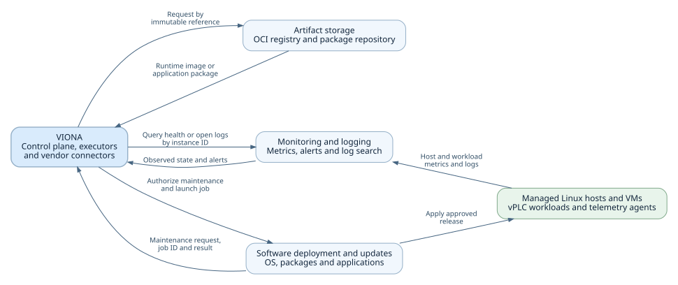

# Infrastructure lifecycle management

VIONA is designed to give plant engineers one place to manage the lifecycle of the infrastructure that runs their virtual PLCs. From a controller or host in the fleet view, an operator will be able to inspect its health, open the relevant logs, select a software release, request deployment or maintenance, and follow the result.

A site can connect the open-source or proprietary tools it already operates and choose a provider independently for each function. VIONA will keep the relationship between the host, workload instance, controller and requested change. The connected systems will store artifacts, collect and retain telemetry, and carry out installation and update jobs. The integrations below describe the proposed design.

## External subsystems

[Open the full-size diagram](assets/infrastructure-lifecycle.svg).

| Subsystem | What the external system does | How VIONA uses it |
| --- | --- | --- |
| **Artifact storage** | Stores versioned runtime images in an OCI registry and vendor-native PLC application packages in a package repository or object store. | The operator selects a release. The executor retrieves the runtime image, or the vendor connector retrieves the PLC package, by its recorded reference and verifies the digest. |
| **Monitoring and logging** | Site agents and collectors monitor physical hosts, VMs and containers, collect system and application logs, and send telemetry to the site's monitoring and log storage systems. | VIONA queries health observations, receives alerts and links to logs filtered by workload identity and time. The fleet view associates host metrics with the affected controllers and shows the source and age of each observation. The vendor connector supplies the controller's own operating state. |
| **Software deployment and updates** | Installs and updates operating system packages, host services and supporting application software on the selected machines. Tracks each installation job and its outcome. | VIONA checks the affected workloads and releases an approved job to the deployment system. It records the external job ID and result alongside its own operation ID. The node agent and vendor connector verify host and controller recovery. |

Potential providers include Harbor or JFrog Artifactory for OCI images, Prometheus and Loki or Datadog for telemetry, and Ansible AWX or Red Hat Satellite for software maintenance. A deployment can mix providers. Each integration exposes the actions supported at that site, such as opening a filtered log view, reading alerts or starting a job. Vendor-specific PLC application deployment follows the [controller deployment flow](architecture.md#deployment-flow).

## Example of host maintenance

An operator requests a kernel update on a Linux host running several vPLCs. VIONA identifies every affected instance and checks how each controller can be kept in service or stopped in an agreed window. A controller may switch to a confirmed standby, or a portable instance may move to an eligible host under its operating policy. If any controller lacks a viable plan, the operator sees which one blocks the update before other workloads are disturbed.

Once every affected controller is accounted for and its planned transition is confirmed, VIONA authorizes the update for that host. If the site's deployment tool starts the workflow, its job requests the same authorization before the first disruptive step. After installation, the external system reports its result. VIONA checks the host, workloads and controller states before the operator closes the maintenance operation.
